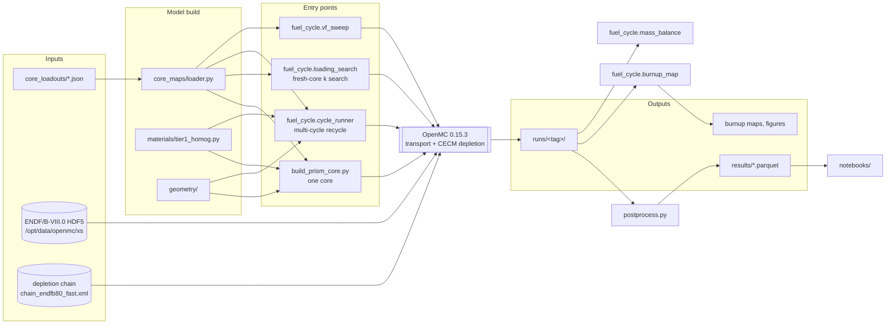
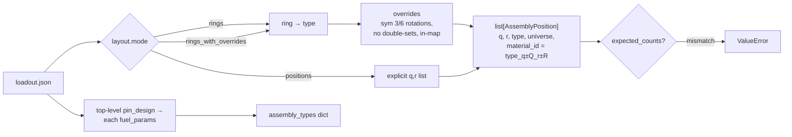
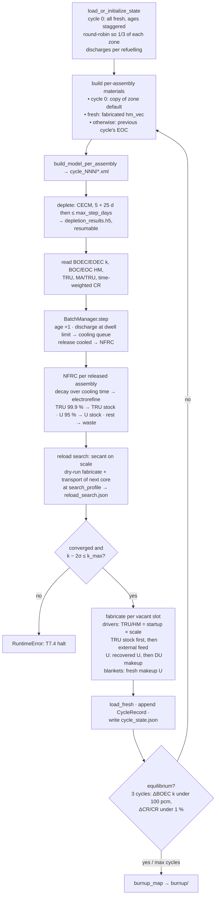

# Architecture

How the PRISM fuel-cycle model is put together: where each piece of the code sits, how
data moves from a JSON loadout to Parquet results, and how the multi-cycle loop keeps
track of every assembly and every gram of heavy metal. For what the project studies and
how to run it, see `README.md`. For the acceptance tests (T1–T7) referenced below, see
`PRISM_Simulation_Testing_Requirements.md`.

## 1. Overview



The code is in layers, and lower layers never import higher ones:

| Layer | Modules | Imports OpenMC? |
|---|---|---|
| Inputs | `core_loadouts/*.json` | — |
| Pure bookkeeping | `fuel_cycle/state.py`, `batch_manager.py`, `nfrc.py`, `search.py`, `core_maps/loader.py`, `geometry/hexmap.py`, `geometry/params.py` | No (`nfrc.py` uses OpenMC's mass table if it can) |
| Model construction | `materials/tier1_homog.py`, `geometry/universe_factory.py`, `build_prism_core.build_model*` | Yes |
| Orchestration | `build_prism_core.py` (CLI), `fuel_cycle/loading_search.py`, `cycle_runner.py`, `vf_sweep.py` | Yes |
| Analysis | `postprocess.py`, `fuel_cycle/burnup_map.py`, `mass_balance.py`, `visualize_geometry.py`, `notebooks/` | Yes |

Because of this split, the bookkeeping (batching, reprocessing, the search) can be tested
on the host without OpenMC. Most of `tests/` does exactly that.

## 2. Runtime environment

```
host (Rocky 10, 2 × 24-core NUMA nodes)
 └─ ./run_openmc.sh  ──docker run──▶  prism-openmc image (openmc/openmc:v0.15.3 + pyarrow, pandas, jupyterlab)
      --cpuset-cpus / --cpuset-mems = one NUMA node   (NUMA_NODE=0|1, THREADS=n)
      -v $PWD → /work                 (repo; outputs written as root)
      -v /opt/data/openmc/xs → /xs    (cross_sections.xml, read-only)
      -v /opt/data/openmc/chain → /chain
```

- Every OpenMC command goes through `run_openmc.sh`. The wrapper sets
  `OPENMC_CROSS_SECTIONS`, the OpenMP and BLAS thread counts, and checks that the
  cross-section and chain files exist before it runs anything.
- Each container is pinned to one NUMA node, so two jobs can run side by side without
  sharing cores or memory. `run_overnight.sh` does this with a cycle run on node 0 and
  the fuel-comparison matrix on node 1.
- `run_jupyter.sh` starts JupyterLab in the same image for `notebooks/`. It isn't pinned
  to a node.
- Cross sections are evaluated at operating temperature (`settings.temperature =
  interpolation`). `_require_temperatures` refuses to build a model with any material
  left at the 293.6 K default.

## 3. Inputs: the loadout

A loadout JSON file fully describes one core: the layout, the assembly types, and the fuel
in each type. `core_maps/loader.py` turns it into a flat list of positions:



- **`load_core(path)`** returns `(positions, asm_types)`, and **`load_axial(path)`**
  returns the active height (`Prism3D`).
- **Coordinates** are axial `(q, r)` in OpenMC's flat-top `HexLattice` frame: `(0, n)`
  points straight up, and each ring runs clockwise from the top.
  `hexmap.axial_to_xy` and `ring_angle_sort` must agree with OpenMC on this, and
  `tests/test_hexmap.py` checks every slot against a real lattice.
- **`material_id`** is a stable name for each slot, such as `inner_fuel_q+1_r-2`. The
  cycle runner adds the load cycle (`…_c004`) to name each physical assembly.
- **`fuel_params`** keys the model reads:

  | Assembly kind | Keys |
  |---|---|
  | Drivers | `pu_hm_frac`, `pu_vector`, `u_vector` (a name or a weighted blend), `zr_frac` |
  | Blankets | `u235_frac` |
  | Both | `pin_design` or `volume_fractions` |

- **Assembly kind comes from the universe.** A type is a driver when its universe is
  `u_inner_fuel` or `u_outer_fuel`, and a blanket when it is `u_internal_blanket` or
  `u_radial_blanket`. Every other universe is structural.

## 4. Model construction

### 4.1 Materials (`materials/tier1_homog.py`)

The inside of each fuel or blanket duct is **one smeared material**: fuel slug, sodium,
and clad/wire steel mixed by volume fraction, each at its theoretical density. The duct
wall and the gap between ducts are separate cells (§4.2), so the pin design's whole-cell
fractions are converted into fractions of the duct interior:

```
PIN_DESIGNS[name]  (whole lattice cell: fuel, bond, coolant, structure)
   └─ recipe_from_cell_fractions()  subtract duct steel + gap sodium, add bond Na
        └─ SmearRecipe(fuel, sodium, steel)   (interior fractions; remainder = void)
             └─ make_smeared_fuel(hm_vec, zr_frac, recipe)  → openmc.Material at T_INTERIOR_K
```

- **Heavy metal (HM).** `make_smeared_driver` combines `U_VECTORS` (blended by
  `resolve_u_vector`) and `PU_VECTORS` according to `pu_hm_frac`. That fraction is clamped
  at 0.35 and multiplied by `FISSILE_SCALE`. `make_smeared_blanket` makes U metal with
  no Zr.
- **The same function, `make_smeared_fuel`, builds every fuel material**: the startup
  drivers, the blankets, and (through `cycle_runner`) the fabricated reloads. A recycled
  assembly therefore uses the same density model as a startup one.
- **Structural materials** are sodium, HT9 (Fe/Cr), steel reflector and shield, B₄C, and
  sodium–steel mixes for the IHX annulus and the two plena. They are kept at the coolant
  temperature or, for the plena, at the inlet and outlet temperatures. Sodium density
  follows Fink & Leibowitz as a function of temperature.
- **`make_materials_from_loadout(asm_types)`** returns `(openmc.Materials, mats_dict)`.
  It creates one zone-default material per driver or blanket universe
  (`fuel_driver_inner_homog`, and so on) plus the structural set.

### 4.2 Geometry (`geometry/`)

**Assembly universe** (`UniverseFactory`): every lattice cell has three regions.

```
 ┌──── pitch 16.142 cm ────┐
 │ sodium (gap, 0.432 cm)  │   background cell  (+duct_outer)
 │  ┌───── HT9 duct ────┐  │   duct cell        (0.394 cm wall)
 │  │ interior material │  │   interior cell    "<name>_interior_region"
 │  └───────────────────┘  │
 └─────────────────────────┘
```

What fills the interior depends on the assembly kind:

| Universe | Interior |
|---|---|
| Fuel / blanket | Smeared fuel material |
| Control (`u_control`) | B₄C |
| Ultimate shutdown | B₄C at higher density |
| `u_control_withdrawn`, GEM, source | Sodium |
| Reflector, shield | Steel |
| `u_empty` (corner notches) | Sodium only, with no duct |

The PRISM loadouts use `u_control_withdrawn` (rods out). `prism_cr072` puts the absorbers
in.

**Root geometry** (side view). The build has 9 cells inside vacuum boundaries:

```
 z ▲   ┌───────────── upper end plate (HT9) ─────────────┐ vacuum
   │   │ upper plenum (Na+15% steel)      │ vessel wall  │
   │   ├──────────────────────┬───────────┤   (HT9)      │
   │   │ active core:         │ IHX pool  │              │
   │   │ HexLattice (r ≤ 195) │ Na+30%    │ r 240–244 cm │ vacuum
   │   ├──────────────────────┴───────────┤              │
   │   │ lower plenum (Na+35% steel)      │              │
   │   └───────────── lower end plate (HT9) ─────────────┘ vacuum
```

Dimensions are in `VesselGeom` and `AssemblyGeom` (`geometry/params.py`). The active
height comes from the loadout.

### 4.3 Two model builders (`build_prism_core.py`)

| | `build_model(loadout, profile)` | `build_model_per_assembly(positions, per_asm_mats, base_mats, …)` |
|---|---|---|
| Used by | CLI, `loading_search`, `vf_sweep` | `cycle_runner` (cycles and reload searches), `mass_balance` |
| Fuel materials | One shared material per zone, with volume = count × assembly volume | One material per assembly, with volume = one assembly |
| Tally filters | `CellFilter` on zone interior cells | `MaterialFilter` on per-assembly materials |
| Extra tallies | Fission split by zone, blanket breeding, flux and leakage spectra | `fission_by_assembly` (power shape) |
| Shared tallies | CR production/destruction, TRU fission, leakage | Same |
| Side effects | Writes `core_*.png` and `core_assignment.csv` to the **current directory** | None |

Both builders use the same root cells, a fission source spread uniformly over the active
box, and a 9×9×6 Shannon-entropy mesh. The conversion ratio comes from two tallies:

    CR = (n,γ on U-238 + Pu-240) / (absorption in U-235 + Pu-239 + Pu-241)

Run statistics come from `RUN_PROFILES`:

| Profile | Particles × batches (inactive) | Depletion steps (days) |
|---|---|---|
| `smoke` | 2 000 × 25 (10) | 30, 30 |
| `quick` | 10 000 × 60 (20) | 5, 25, 60, 90, 90, 90 |
| `cycle` | 5 000 × 60 (20) | 5, 25, 60, 90, 90, 90 |
| `standard` | 10 000 × 80 (20) | 36 × 30 |
| `production` | 5 000 000 × 600 (100) | 36 × 30 |

## 5. Pipelines

### 5.1 Single core: `build_prism_core.py`

```
loadout ─▶ build_model ─▶ export XML to runs/<tag>/ ─▶ write run_info.json
                                │
                 ┌──────────────┴───────────────┐
           (default)                       --deplete
        model.run() → statepoint.N.h5    CoupledOperator + CECMIntegrator
                                          at 840 MWth over the profile's steps
                                          → depletion_results.h5 (resumes if present)
```

`run_tag` is the loadout name, with `__<profile>` added for any profile other than
`standard`. `run_info.json` records the profile, temperatures, `fuel_params`, the
resolved volume fractions and the cross-section path. `postprocess.py` turns this into
`metadata.parquet`.

### 5.2 Fresh-core loading search: `fuel_cycle/loading_search.py`

The search finds one dimensionless **scale** on the driver fissile loading that gives a
target BOC k-eff:

- **Knob** (`search.loading_knob`). With Pu in the drivers, the knob is `tru`: it scales
  `pu_hm_frac` in every driver zone and keeps the inner/outer ratio. With U only, the knob
  is `u_fissile`: it scales the enriched parts of `u_vector`, and DU fills the rest.
- **Bounds** (`scale_bounds`). The upper bound is `Pu/HM ≤ 0.35`, or for uranium, an
  enriched share of the blend no greater than 1. A HALEU core therefore stops at 19.75 %
  U-235.
- **Root finder** (`secant_search`). The first step assumes a fissile worth
  `dk/k ≈ 0.6·dx/x`. Later steps are secants. A point is accepted when
  `|k − target| ≤ max(tol, 2σ)`. The finder returns `converged=False` when it is pinned
  at a bound or runs out of iterations.
- **Output.** `runs/<loadout>__search[__profile]/iter_NN/` holds the trial solves, and
  `search_result.json` holds the result. The searched loadout (the `*_k103.json` files)
  carries a `loading_search` provenance block.

### 5.3 Closed fuel cycle: `fuel_cycle/cycle_runner.py`

This is the Tier-2 loop. Each fuel and blanket assembly is its own depletable material,
and the cycle state is saved to disk after every cycle, so the run can be restarted.



The main design decisions:

- **Fixed slots, unique assemblies.** Assemblies never move. A discharged slot gets a
  fresh assembly under a new name (`slot_cNNN`), so it can never inherit an old
  composition. The batch policy is FIFO by age within each zone (`BatchConfig`): drivers
  stay 3 cycles, blankets stay 4 (`--blanket-cycles`), and everything cools for 1 cycle.
- **What carries over between cycles.** An assembly enters the next cycle with exactly
  the composition it had at the end of the last one, read from `depletion_results.h5`
  (`Results.export_to_materials`) and including fission products. `cycle_state.json`
  holds no compositions. It holds only the bookkeeping needed to rebuild the next core.
- **Exact fabrication ledger.** A fresh assembly keeps its zone reference's Zr, Na and
  steel atom densities and its **total HM atom density**. Only the HM isotopic vector
  changes (`_fresh_material`), so grams fabricated equal grams loaded.
- **Pyroprocessing model** (`nfrc.py`). All TRU is recovered together, with no separate
  Pu stream. U is recovered separately. Out-of-core decay covers five single-step chains
  (Pu-241→Am-241, Cm-244→Pu-240, Pu-238→U-234, Np-239→Pu-239, Cm-242→Pu-238). External
  makeup uses `PU_VECTORS[--external-feed]`.
- **Reload search.** It starts from the previous reload's scale. Each trial builds the
  next core from copies of the stocks (`dry_run=True`) and then deletes the trial
  directories. The upper bound keeps the reload under 0.35 TRU/HM.

**`CycleState`** (`fuel_cycle/state.py`, written to `cycle_state.json`):

```
CycleState
├─ loadout_name, current_cycle
├─ in_core: {material_id → InCoreEntry(q, r, type, cycle_loaded, cycles_in_core,
│                                       position_id, fresh_hm_vec)}
├─ cooling_queue: [CoolingEntry(material_id, type, cycles_remaining, source_cycle, hm_g)]
├─ cycle_records: [CycleRecord(k BOEC/EOEC ± σ, CR, TRU kg, MA/TRU, fissile BOC/EOC,
│                              fresh/external TRU, makeup U, TRU stock, reload scale, …)]
├─ tru_stock_g, u_stock_g          recovered material awaiting fabrication
└─ ledger_g                        cumulative: initial_tru/u, external_tru, makeup_u,
                                   nfrc_in, decay_loss, waste, fabricated
```

**Run directory**:

```
runs/<loadout>__cycles[__<profile>]/
├─ cycle_state.json
├─ cycle_000/  {materials,geometry,settings,tallies}.xml
│              openmc_simulation_n{i}.h5   (one per depletion step; CR source)
│              depletion_results.h5
│              reload_search.json
├─ cycle_001/ …
└─ burnup/     burnup.parquet, cycle_NNN_burnup.png
```

### 5.4 Pin-design sweep: `fuel_cycle/vf_sweep.py`

For each Till & Chang Table 14-3 design (`tc_d090`–`tc_d120`), the sweep runs a loading
search with only the volume fractions changed, then records the searched TRU fraction and
CR against the values in Triplett Table II. The output goes to `runs/vf_sweep/`, and
`summarize` writes `summary.csv` and `vf_sweep.png`.

## 6. Outputs and analysis

| Tool | Reads | Writes |
|---|---|---|
| `postprocess.py` | Each top-level `runs/<tag>/`: `depletion_results.h5`, the last `statepoint.*.h5`, `materials.xml`, `run_info.json` | `results/{keff,inventories,tallies,spectra,metadata}.parquet`, joined on `run_tag` |
| `fuel_cycle.burnup_map` | Every `cycle_NNN/` of a cycle run | Per-assembly MWd/kg table and core maps |
| `fuel_cycle.mass_balance` | `cycle_state.json` plus every cycle's results | Pass/fail on whole-system HM closure within 0.1 % (T4.3) |
| `visualize_geometry.py` | Loadout (OpenMC plot mode, no transport) | `figures/geometry/<loadout>/` |
| `notebooks/01–05` | `results/*.parquet` | Criticality, breeding, spectra, leakage, inventories |

Two details of how the analysis tools compute their numbers:

- **Burnup.** A fission removes one HM atom, so `burnup_map` shares each cycle's thermal
  energy among assemblies in proportion to their HM-atom loss, then divides by the HM
  mass each assembly was loaded with.
- **Mass balance.** The check is: initial + external + makeup = burned + in core +
  cooling + stocks + waste + decay loss.

## 7. Tests

`tests/` (pytest; most of it runs without OpenMC):

| File | Covers |
|---|---|
| `test_loader.py` | Every loadout loads and matches `expected_counts`; ring/override rules, `sym`, active height |
| `test_hexmap.py` | `axial_to_xy` and ring ordering agree with a real `openmc.HexLattice` (needs OpenMC) |
| `test_batch_manager.py` | Staggered startup, discharge timing, cooling-queue order |
| `test_nfrc.py` | Electrorefiner splits, decay, fabrication draws and shortfalls |
| `test_search.py` | Secant convergence, noise tolerance, bounds, loading knobs |
| `test_state.py` | JSON round trip of `CycleState` |
| `test_temperature.py` | Every material has a temperature; sodium density |

## 8. Known gaps and sharp edges

- **U-only drivers can't be reloaded.** `CycleRunner._reload` raises
  `NotImplementedError` when a driver's startup TRU fraction is zero. That rules out a
  cycle run of `prism_haleu` or of the HALEU and WG-U `fueltest_`/`matchedk_` loadouts.
  Single-core runs and depletion of those loadouts work. A HALEU-to-TRU
  transition reload, with external enriched U as a makeup stream, is the missing piece.
- **`postprocess.py` only reads top-level run directories.** Cycle runs keep their
  results in `cycle_NNN/`, so they reach Parquet only through `burnup_map` and
  `cycle_state.json`.
- **`build_model` writes debug maps into the current directory.** That is why
  `core_loading_map.png`, `core_qr_labels.png`, `core_ring_index_map.png` and
  `core_assignment.csv` sit in the repo root and are overwritten on every run.
- **Two settings look configurable but aren't used.** `NFRCConfig.cooling_cycles` is
  never read; the cooling time comes from `BatchConfig`. `FISSILE_SCALE` scales only
  `pu_hm_frac`.
- **The physics is Tier-1.** Assemblies are homogenised (no pin heterogeneity), the
  interior temperature is assumed to be 900 K, and absorbers are withdrawn. Out-of-core
  decay uses only five chains. Results are provisional until the Triplett benchmarks
  (T6) pass.
- **Legacy code paths remain.** `core_maps/*_assignment.py` and
  `tier1_homog.make_materials()` are from before the JSON-loadout design. Only
  `_gen_qr_map.py` and an unused import in `build_prism_core.py` still reference them.
