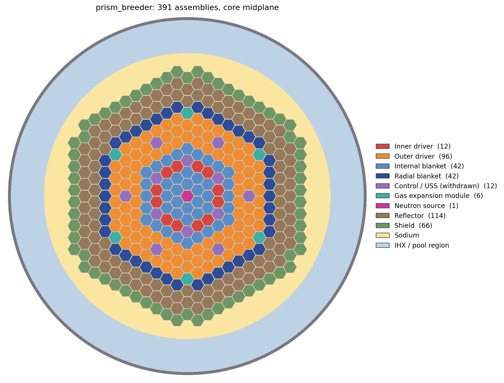
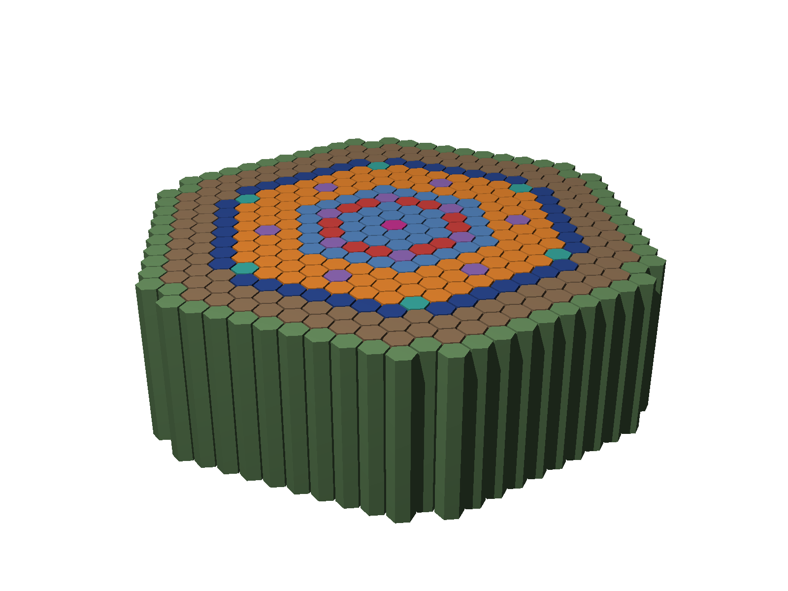
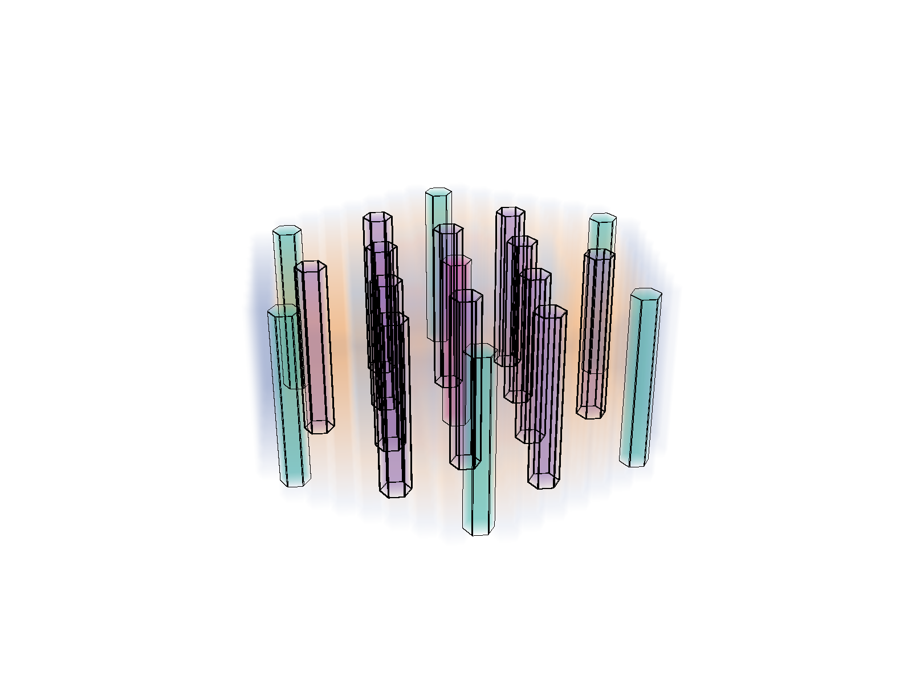
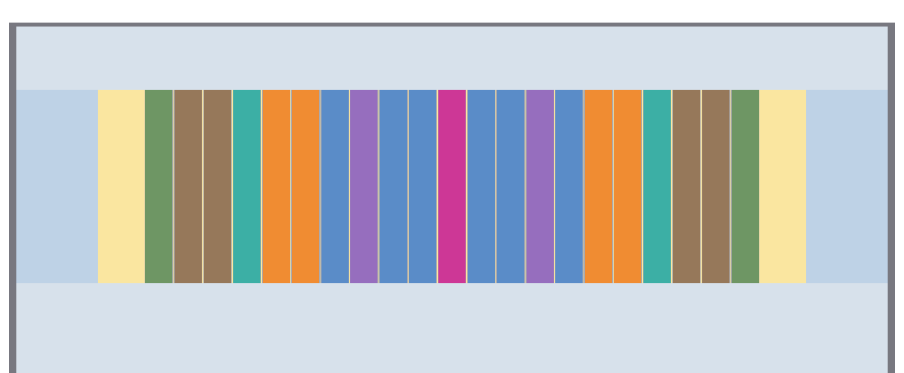

# PRISM Fuel Cycle — OpenMC Simulation

Tier-1 (homogenized) neutronics model of a PRISM/ABR-like sodium-cooled fast reactor,
built to study blanket breeding performance under different uranium feed strategies.

## Architecture

```
build_prism_core.py      ← main entry point
    │
    ├── core_maps/       ← radial zone assignment (which ring = which assembly type)
    ├── geometry/        ← assembly geometry, hex lattice construction
    ├── materials/       ← homogenized material definitions
    │
    └── runs/            ← one subdirectory per permutation (git-ignored)
         └── NUint_NUrad/
              ├── statepoint.80.h5
              └── depletion_results.h5

postprocess.py           ← extracts results → results/*.parquet (git-ignored)
notebooks/               ← analysis notebooks reading from results/
```

## Core geometry

Default figures are of the **breeder** core (`core_loadouts/prism_breeder.json`).
Regenerate with `./run_openmc.sh python visualize_geometry.py [loadout]`; output goes to
`figures/geometry/<loadout>/`.

| Breeder (CR 1.23) | UNF recycle (CR 0.72), cf. Triplett 2012 Fig. 8 |
|---|---|
|  |  |

| 3-D cutaway (sodium, vessel, plena hidden) | Absorber, GEM and source columns |
|---|---|
|  |  |

Axial slice through the core centre (x = 0), showing the active core between the lower and
upper plena and the IHX/pool annulus:



Tier-1 assemblies are homogenised: each one is a sodium gap, an HT9 duct and one smeared
interior material (fuel, sodium and steel mixed by volume fraction). There are no pins yet:


## Core loadouts

Each core is a JSON file in `core_loadouts/`. A layout gives every ring a base assembly
type, then overrides individual positions for rods, GEMs, the source and the corner notch:

```json
"layout": {
  "mode": "rings_with_overrides",
  "rings": [
    {"range": [0, 5], "type": "inner_fuel"},
    {"range": [6, 8], "type": "outer_fuel"},
    {"range": [9, 10], "type": "reflector"},
    {"range": [11, 11], "type": "shield"}
  ],
  "overrides": [
    {"q": 0, "r": 0, "type": "source"},
    {"q": 0, "r": 3, "sym": 3, "type": "control"},
    {"q": 3, "r": 3, "sym": 6, "type": "control"},
    {"q": 0, "r": 7, "sym": 6, "type": "gem"}
  ]
},
"expected_counts": {"inner_fuel": 84, "outer_fuel": 108, "control": 9, "gem": 6}
```

- **Coordinates** are axial `(q, r)` on the flat-top lattice: `(0, n)` is straight up,
  `(n, -n)` lower-right and `(-n, 0)` lower-left. `_gen_qr_map.py` draws a labelled map.
- **`sym`** places the override and its rotational images: `3` for every 120°, `6` for
  every 60°. One line gives a full set of six GEMs.
- **Checks:** the loader rejects overrides outside the ring map and positions overridden
  twice. When `expected_counts` is present, the loaded core must match it exactly.
- **Other modes:** `"rings"` (no overrides) and `"positions"` (one explicit entry per slot,
  for shuffled Tier-2 states).

The four Triplett (2012) cores, all 391 assemblies (Table III):

| Loadout | Drivers | Int. blanket | Rad. blanket | Driver TRU (wt%) | Height (cm) |
|---|---|---|---|---|---|
| `prism_unf_recycle` | 84 + 108 | — | — | 18.9 / 22.7 | 66.0 |
| `prism_breakeven` | 108 | 42 | 42 | 21.1 | 106.7 |
| `prism_breeder` | 108 | 42 | 42 | 20.9 | 106.7 |
| `prism_weapons_pu` | 108 | 42 | 42 | 18.3 (WG Pu) | 106.7 |

All four have 9 control, 3 ultimate shutdown, 1 source, 6 GEMs, 114 reflector and 66 shield
assemblies at the Fig. 8 positions, with absorbers withdrawn. `prism_cr072` is the UNF core
with the absorbers inserted. Triplett publishes a map only for the UNF core, so the
internal-blanket rings (1, 2 and 4) in the other three are a project choice.

## Permutation system

Four blanket feed configurations are run automatically:

| Directory | Internal blanket | Radial blanket |
|-----------|-----------------|----------------|
| `NUint_NUrad` | Natural U | Natural U |
| `NUint_DUrad` | Natural U | Depleted U |
| `DUint_NUrad` | Depleted U | Natural U |
| `DUint_DUrad` | Depleted U | Depleted U |

## Running

```bash
# Build custom Docker image (first time, or after Dockerfile changes)
docker build -t prism-openmc .

# Transport only for one loadout (add --profile quick for a fast screen)
./run_openmc.sh python build_prism_core.py core_loadouts/prism_breeder.json

# Full depletion (~90 min)
./run_openmc.sh python build_prism_core.py core_loadouts/prism_breeder.json --deplete

# Geometry figures (plot mode only, no transport)
./run_openmc.sh python visualize_geometry.py core_loadouts/prism_breeder.json

# Extract results to Parquet
./run_openmc.sh python postprocess.py
```

## Results

`postprocess.py` writes five Parquet files to `results/`:

| File | Contents |
|------|----------|
| `keff.parquet` | k-eff vs time for each depleted run |
| `inventories.parquet` | Key nuclide masses vs time per material |
| `tallies.parquet` | Scalar tallies at final step (fission split, breeding, leakage) |
| `spectra.parquet` | Energy-binned flux and leakage spectra at final step |
| `metadata.parquet` | Run provenance (OpenMC version, particle counts, timestamps) |

## Tier roadmap

| Tier | Description | Status |
|------|-------------|--------|
| 1 | Homogenized geometry, no reactivity control | **Complete (POC)** |
| 2 | Homogenized + GEMs + control rods, criticality search | Planned |
| 3 | Pin-level geometry | Future |

## Key design parameters

| Parameter | Value |
|-----------|-------|
| Assembly pitch | 16.142 cm |
| Active height | 101.60 cm |
| Max ring | 11 |
| Pu/HM (inner) | 0.20 |
| Pu/HM (outer) | 0.17 |
| Thermal power | 840 MWth |
| Depletion step | 30 days |
| Pu vector | Pu239=55%, Pu240=25%, Pu241=12%, Pu242=8% |
