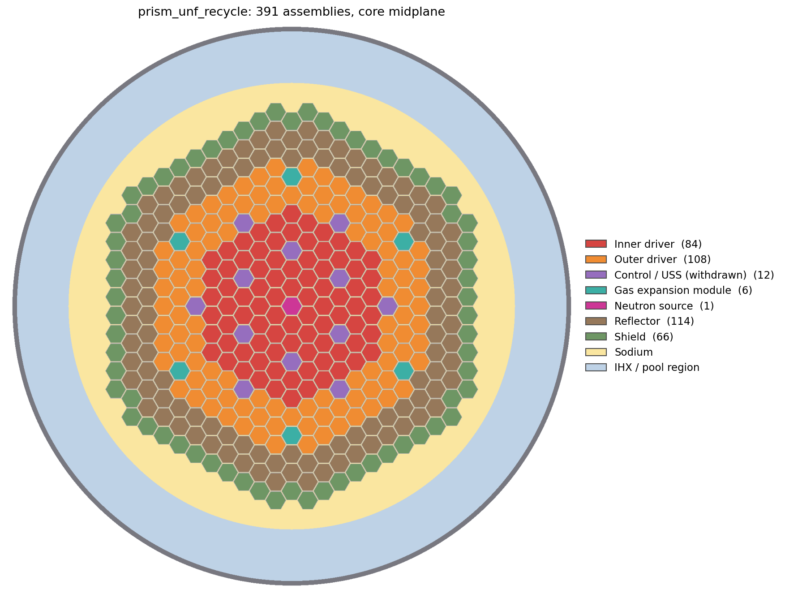

# PRISM Fuel Cycle — OpenMC Simulation

An OpenMC model of a PRISM-type sodium-cooled fast reactor (840 MWth, metallic U-TRU-Zr
fuel) for comparing **fuel cycles** in one reactor design. The questions it answers include:

- How does the same core perform as a **TRU burner** (recycling LWR spent fuel), a
  **breakeven** core, a **breeder**, and a **weapons-Pu disposition** core?
- What does a closed cycle with on-site **pyroprocessing** do over many cycles: how much
  TRU does each reload need, how much external feed, how do minor actinides build up, and
  where does it reach equilibrium?
- How do different **startup fissile sources** (reactor-grade Pu, weapons-grade Pu, HALEU,
  down-blended HEU) compare at the same reactivity?

The reference designs are the four PRISM cores of Triplett, Loewen & Dooies, *Nucl.
Technol.* 178 (2012) 186 (Tables II–III, Fig. 8), with assembly and pin data from
ANL-AFCI-202 and Till & Chang, *Plentiful Energy*. Sources are listed in `sources/README.md`.

## Fuel cycles modelled

| Loadout | Mission | Triplett CR | Cycle | Driver TRU | Feed vector |
|---|---|---|---|---|---|
| `prism_unf_recycle` | Burn LWR spent-fuel TRU | 0.72 | 12 mo | 18.9 / 22.7 wt% (inner/outer) | LWR SF TRU, 50 MWd/kg, 10-y cooled |
| `prism_breakeven` | Self-sustaining closed cycle | 1.06 | 23 mo | 21.1 wt% | Reactor-grade Pu |
| `prism_breeder` | Net fissile production | 1.23 | 23 mo | 20.9 wt% | Reactor-grade Pu |
| `prism_weapons_pu` | Weapons-Pu disposition | 1.00 | 26 mo | 18.3 wt% | Weapons-grade Pu |

Variants:

- **`*_k103`**: the same core with the driver TRU fraction searched so the fresh core has
  BOC k-eff = 1.03 (`fuel_cycle.loading_search`). The searched scale is recorded in the
  file's `loading_search` block.
- **`prism_cr072`**: the UNF core with all absorbers inserted; use it with
  `prism_unf_recycle` to compute rod worth.
- **`abr1000_breakeven`**: ABR-1000-style three-zone core with no blankets.
- **Fresh-fuel comparison** (breakeven layout, one fissile source each):
  - `fueltest_*` use fixed enrichments: HALEU and WG-U both at 16.5 % U-235, RG-Pu at
    21 % Pu/HM, WG-Pu at 17 % Pu/HM.
  - `matchedk_*` use loadings searched to k = 1.005.

## Closed fuel cycle

`fuel_cycle.cycle_runner` runs a core through repeated cycles:

```
BOC core ──transport + depletion──▶ EOC core
   ▲                                   │ discharge oldest batch
   │                                   ▼
fresh fuel ◀── fabrication ◀── NFRC pyroprocessing ◀── in-vessel cooling
   ▲              (U + TRU)       (electrorefiner:          (≥ 1 cycle)
   └─ external TRU makeup if the recovered stock runs short   all TRU co-recovered)
```

- **Per-assembly depletion.** Every fuel and blanket assembly has its own material,
  named by lattice slot and load cycle (e.g. `inner_fuel_q+1_r-2_c004`).
- **Batch management** (`batch_manager.py`): driver and blanket residence times, discharge,
  and the cooling queue.
- **Reprocessing and fabrication** (`nfrc.py`): recovers U and all TRU together, with no
  separate Pu stream, and fabricates fresh U-TRU-Zr from the recovered stock. External
  makeup uses `--external-feed reactor_grade | weapons_grade | lwr_sf_tru`.
- **Reload search**: each reload's TRU fraction is searched to the BOEC k target
  (`--k-target`). The run stops if a reload exceeds `--k-max`.
- **Bookkeeping**: the state is saved to `cycle_state.json` after every cycle, so a run can
  be restarted. `mass_balance.py` checks heavy-metal closure across the whole system, and
  `burnup_map.py` writes per-assembly burnup tables and maps.

Each cycle prints its BOC/EOC k-eff, in-core TRU, MA/TRU, conversion ratio, and the reload
mass, including how much came from outside. The acceptance tests (k-eff band, CR against
Triplett, discharge burnup, cooling time, Doppler, etc.) are in
`PRISM_Simulation_Testing_Requirements.md`.

## Running

Everything runs in the `prism-openmc` Docker image through `./run_openmc.sh`. It uses
ENDF/B-VIII.0 at operating temperature. Exit code 127 from the wrapper is harmless.

```bash
docker build -t prism-openmc .                       # first time / after Dockerfile changes

# Single core: transport, or one depletion cycle
./run_openmc.sh python build_prism_core.py core_loadouts/prism_breeder.json [--profile quick]
./run_openmc.sh python build_prism_core.py core_loadouts/prism_breeder.json --deplete

# Fresh-core loading search to a target k
./run_openmc.sh python -m fuel_cycle.loading_search core_loadouts/prism_breakeven.json --k-target 1.03

# Multi-cycle closed fuel cycle
./run_openmc.sh python -m fuel_cycle.cycle_runner core_loadouts/prism_breakeven_k103.json \
    --profile cycle --k-target 1.03 --cycles 20

# Fresh-fuel comparison matrix
./run_fuel_tests.sh quick [--deplete]

# Pin-design / fuel-volume-fraction sweep
./run_openmc.sh python -m fuel_cycle.vf_sweep run core_loadouts/prism_breeder.json
./run_openmc.sh python -m fuel_cycle.vf_sweep summarize

# Results, burnup maps, geometry figures
./run_openmc.sh python postprocess.py
./run_openmc.sh python -m fuel_cycle.burnup_map runs/<run> [--cycle N | --all]
./run_openmc.sh python visualize_geometry.py [loadout]
```

`--profile smoke|quick|cycle|standard|production` sets the particle counts and the
depletion schedule (`RUN_PROFILES` in `build_prism_core.py`). Output goes to `runs/` and is
owned by root, so delete it with `./run_openmc.sh rm -rf runs/<dir>`. Unit tests are in
`tests/`.

## Code layout

```
build_prism_core.py      single-core model build, transport / depletion
core_loadouts/*.json     one file per core and fuel cycle
core_maps/               JSON loader, ring/override expansion, count checks
geometry/                assembly + vessel dimensions, hex lattice
materials/tier1_homog.py fuel/blanket/structure materials, Pu/TRU/U vectors, pin designs
fuel_cycle/              cycle runner, batch manager, NFRC, loading search, mass balance,
                         burnup maps, VF sweep
postprocess.py           runs/ → results/*.parquet (keff, inventories, tallies, spectra, metadata)
notebooks/               analysis notebooks reading results/
article/                 draft paper
```

## Core geometry

These figures show the breeder core (`prism_breeder`). Regenerate them with
`visualize_geometry.py`, which writes to `figures/geometry/<loadout>/`.

| Breeder (CR 1.23) | UNF recycle (CR 0.72), cf. Triplett 2012 Fig. 8 |
|---|---|
|  |  |

| 3-D cutaway (sodium, vessel, plena hidden) | Absorber, GEM and source columns |
|---|---|
|  |  |


Assemblies are homogenised: each one is a sodium gap, an HT9 duct, and one smeared interior
material. The interior volume fractions come from the pin design (`PIN_DESIGNS`:
ANL-AFCI-202 driver/blanket designs and Till & Chang Table 14-3). Individual pins are not
modelled yet.


All four Triplett cores have 391 assemblies (Table III): 9 control, 3 ultimate shutdown,
1 source, 6 GEMs, 114 reflector and 66 shield, at the Fig. 8 positions, with absorbers
withdrawn. Triplett publishes a map only for the UNF core, so where the 42 internal
blankets go in the other three (rings 1, 2 and 4) is our own choice.

## Loadout format

```json
"layout": {
  "mode": "rings_with_overrides",
  "rings": [
    {"range": [0, 5], "type": "inner_fuel"},
    {"range": [6, 8], "type": "outer_fuel"},
    {"range": [9, 10], "type": "reflector"},
    {"range": [11, 11], "type": "shield"}
  ],
  "overrides": [
    {"q": 0, "r": 0, "type": "source"},
    {"q": 0, "r": 3, "sym": 3, "type": "control"},
    {"q": 0, "r": 7, "sym": 6, "type": "gem"}
  ]
},
"expected_counts": {"inner_fuel": 84, "outer_fuel": 108, "control": 9, "gem": 6}
```

- **Coordinates** are axial `(q, r)` on OpenMC's flat-top lattice, where `(0, n)` is
  straight up. `_gen_qr_map.py` draws a labelled map.
- **`sym`** adds the override's 3- or 6-fold rotational images.
- **`expected_counts`** makes the loader fail if the core does not match. The loader also
  rejects overrides outside the map and positions overridden twice.
- **Other modes:** `"rings"` (no overrides) and `"positions"` (one explicit entry per
  slot).
- **Fuel settings** go in each assembly type's `fuel_params`: `pu_hm_frac`, `pu_vector`,
  `u_vector`, `u235_frac`, `zr_frac` and `pin_design`. The top level of the file can set
  `cycle_length_days`, `active_height_cm` and `pin_design`.

## Status

| Tier | Description | Status |
|---|---|---|
| 1 | Homogenised assemblies, Triplett core layouts, rods/GEMs placed | Done |
| 2 | Per-assembly depletion, batch reloads, NFRC recycle, reload k search, equilibrium | Working; benchmarking against Triplett Table II |
| 3 | Pin-level geometry (heterogeneity effect on CR and Doppler) | Planned |

All results are provisional until the Triplett benchmarks (CR, TRU wt%, discharge burnup)
pass. Runs made before 2026-11-01 used room-temperature (293.6 K) cross sections, and runs
made before 2026-11-15 used a hex frame that put rods, GEMs and notches in the wrong
lattice slots.
